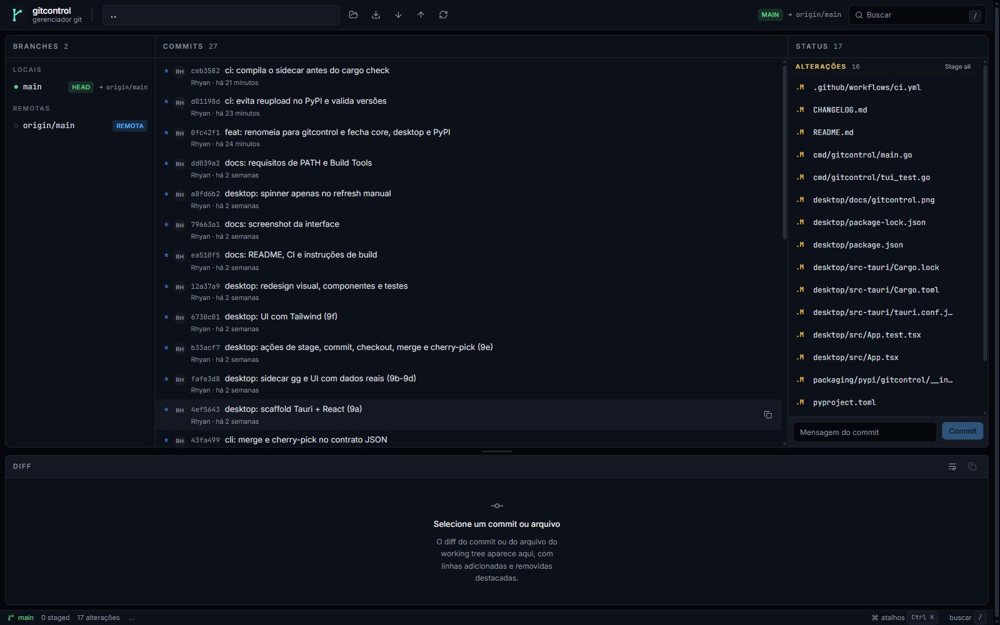

# gitcontrol

[](https://github.com/rhyan05/gitcontrol/actions/workflows/ci.yml)
[](https://pypi.org/project/gitcontrol/)
[](LICENSE)

Gerenciador de Git com três interfaces sobre o mesmo core:

- **TUI** em Go/Bubble Tea para operar tudo pelo terminal.
- **CLI JSON** (`gitcontrol --json`) com contrato estável para automação.
- **Desktop** em Tauri + React para uma experiência visual.



## O que funciona

- Branches: listar, checkout (local e remota com tracking), merge.
- Commits: log, grafo ASCII, diff completo, cherry-pick.
- Working tree: status, diff de arquivo, stage/unstage por arquivo, commit.
- Remotos: fetch, pull e push (com upstream automático no primeiro push).
- Conflitos: marcar resolvido, abortar e continuar merge/cherry-pick; edição no
  editor do sistema/TUI.
- Multi-repo: vários repositórios abertos com troca de ativo.
- Refresh automático na TUI (fsnotify + timer) e na GUI (polling curto).
- Instaladores Windows: `.msi` e `.exe` (NSIS).

## Instalação

### PyPI (CLI + TUI)

```powershell
pip install gitcontrol
gitcontrol --version
gitcontrol
```

### Go

```powershell
go install github.com/rhyan05/gitcontrol/cmd/gitcontrol@latest
```

### Desktop

Baixe o `.msi` ou o instalador NSIS na página de releases do GitHub.

## Arquitetura

```text
cmd/gitcontrol/    entrada única: TUI, --json ou --version
internal/git/      core Go (status, log, grafo, remotes, conflitos, ações)
internal/cli/      contrato JSON (envelope ok/data ou ok/error)
packaging/pypi/    wheel universal com os binários Go embutidos
desktop/           app Tauri + React + Tailwind v4
  src/             UI (componentes, features, hooks, sidecar client)
  src-tauri/       runtime Rust, sidecar e ícones
```

O desktop não reimplementa Git: ele chama o sidecar `gitcontrol --json`, que é
o mesmo binário do core testado em Go.

## Requisitos

- Go 1.27+
- Node.js 22+ e npm
- Rust 1.90+ com toolchain MSVC
- Visual Studio Build Tools com **Desktop development with C++**
- WebView2 Runtime (Windows)

## TUI / CLI

```powershell
go test ./...
go run ./cmd/gitcontrol                 # abre a TUI
go run ./cmd/gitcontrol --version
go run ./cmd/gitcontrol --json --repo . status
go run ./cmd/gitcontrol --json log
go run ./cmd/gitcontrol --json graph
go run ./cmd/gitcontrol --json branches
go run ./cmd/gitcontrol --json show <hash>
go run ./cmd/gitcontrol --json diff <path>
go run ./cmd/gitcontrol --json remotes
go run ./cmd/gitcontrol --json fetch [remote]
go run ./cmd/gitcontrol --json pull [remote] [branch]
go run ./cmd/gitcontrol --json push [remote] [branch]
go run ./cmd/gitcontrol --json checkout <branch>
go run ./cmd/gitcontrol --json merge <branch>
go run ./cmd/gitcontrol --json cherry-pick <hash>
go run ./cmd/gitcontrol --json resolve <path...>
go run ./cmd/gitcontrol --json abort
go run ./cmd/gitcontrol --json continue
go run ./cmd/gitcontrol --json stage <path...>
go run ./cmd/gitcontrol --json unstage <path...>
go run ./cmd/gitcontrol --json commit "mensagem"
```

O contrato é sempre um objeto JSON:

```json
{"ok":true,"data":{...}}
{"ok":false,"error":{"code":"git_error","message":"..."}}
```

Exit code `0` em sucesso e `1` em erro.

Teclas da TUI: `/` não se aplica; use `tab` para trocar de painel, `j/k` para
mover, `enter` para checkout/diff, `d` para diff do arquivo, `s/u` para
stage/unstage, `c` para commit, `M` merge, `C` cherry-pick, `f` fetch, `p` pull,
`P` push, `a` abortar conflito, `x` continuar conflito, `e` editar arquivo em
conflito e `[`/`]` para trocar de repositório.

## Desktop

```powershell
cd desktop
npm install
npm run tauri -- dev
```

O `beforeDevCommand` compila o sidecar automaticamente (`npm run sidecar`) e
inicia o Vite. Para gerar os instaladores:

```powershell
cd desktop
npm run tauri -- build
```

Artefatos:

- `desktop/src-tauri/target/release/bundle/msi/gitcontrol_0.1.1_x64_en-US.msi`
- `desktop/src-tauri/target/release/bundle/nsis/gitcontrol_0.1.1_x64-setup.exe`

Atalhos da GUI: `/` busca, `r` atualiza, `Ctrl/Cmd+K` abre a paleta de comandos,
`Esc` fecha diálogos. O painel de diff é redimensionável pela alça acima dele.

## Qualidade

```powershell
go test ./...
go vet ./...
cd desktop
npm run lint
npm run test
npm run build
cargo check --manifest-path src-tauri/Cargo.toml
```

## Licença

MIT. Veja [LICENSE](LICENSE).
