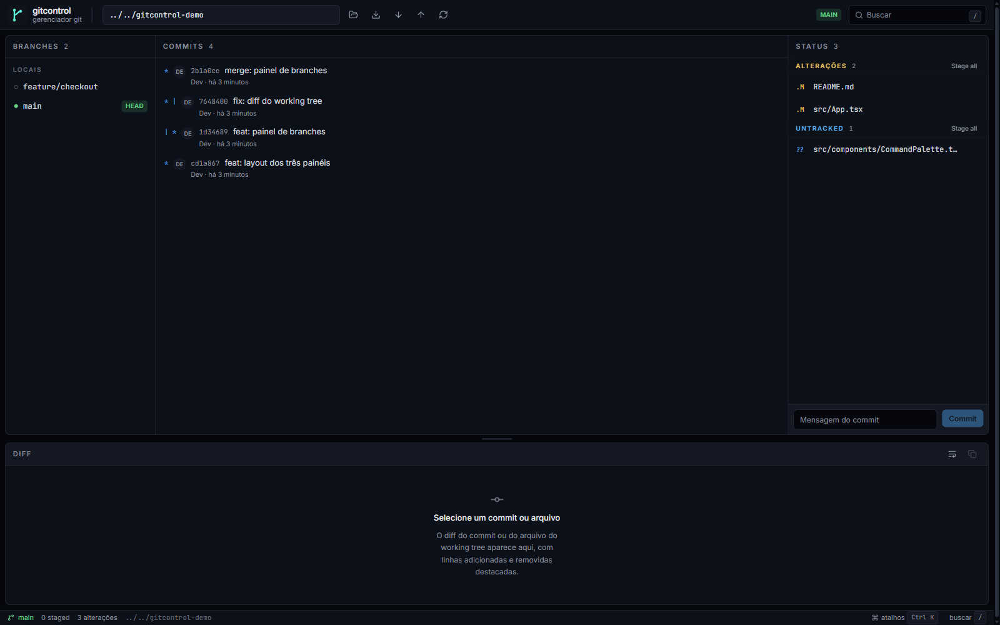
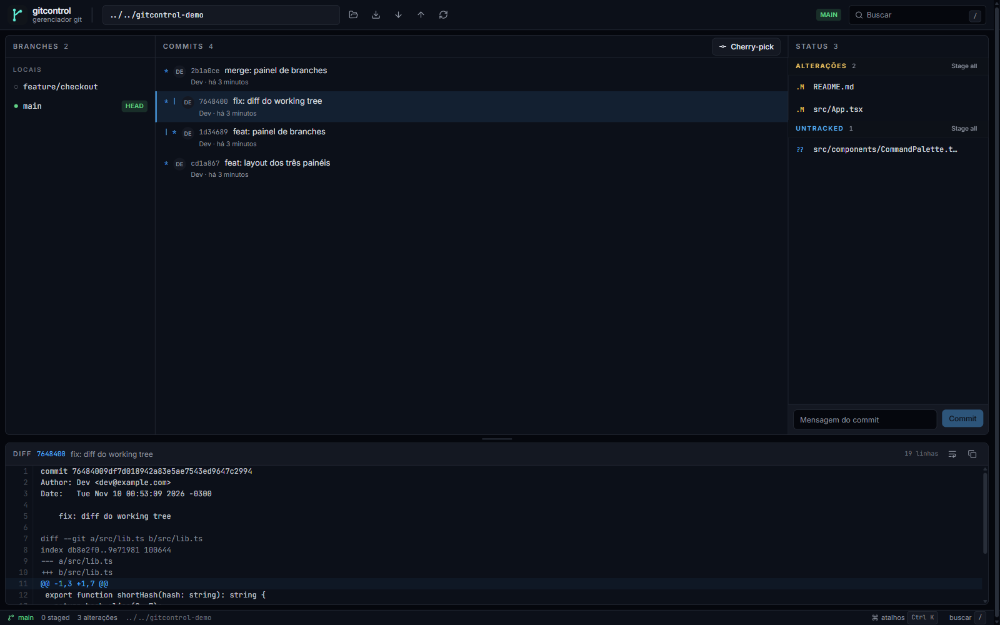
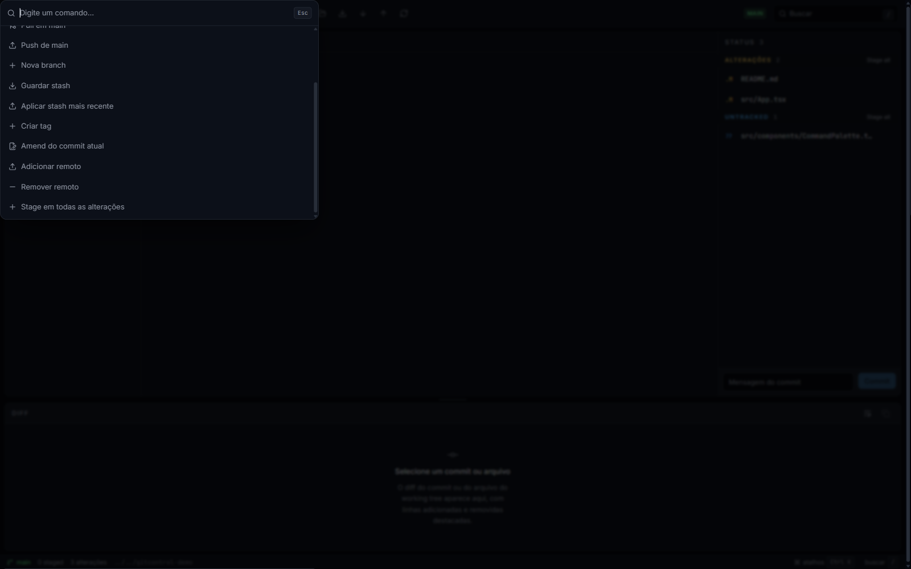
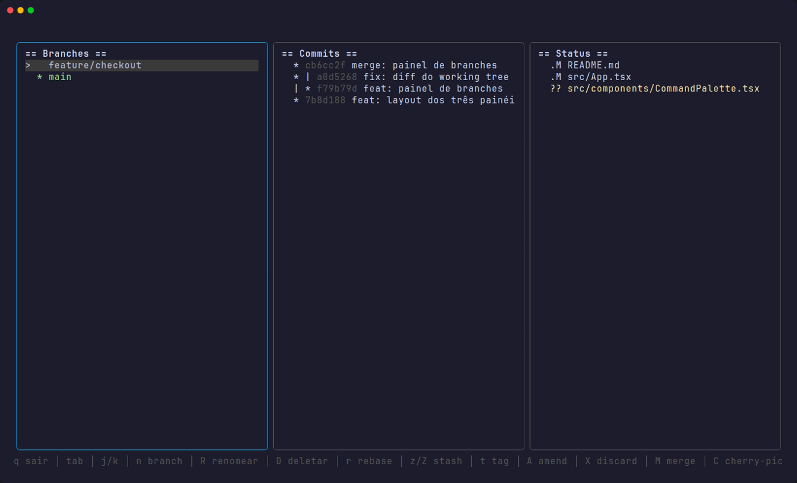
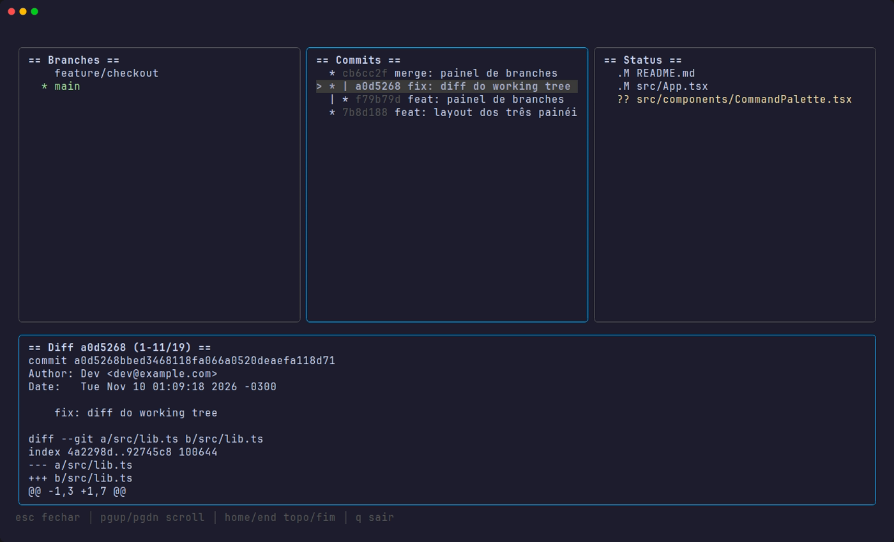

# gitcontrol

[](https://github.com/rhyan05/gitcontrol/actions/workflows/ci.yml)
[](https://pypi.org/project/gitcontrol/)
[](LICENSE)

Gerenciador de Git com três interfaces sobre o mesmo core:

- **TUI** em Go/Bubble Tea para operar tudo pelo terminal.
- **CLI JSON** (`gitcontrol --json`) com contrato estável para automação.
- **Desktop** em Tauri + React para uma experiência visual.

## Capturas

### Desktop







### TUI





> Capturas geradas com um repositório de demonstração.

### CLI JSON

```console
$ gitcontrol --json status
{"ok":true,"data":{"branch":"main","head_oid":"2b1a0ce...","files":[]}}
```

## O que funciona

- Branches: listar, criar, deletar, renomear, checkout (local e remota com
  tracking), merge e rebase.
- Commits: log, grafo ASCII, diff completo, cherry-pick e amend.
- Working tree: status, diff de arquivo, stage/unstage, discard e commit.
- Remotos: listar, adicionar, remover, fetch, pull e push (com upstream
  automático no primeiro push).
- Stash: guardar, listar, aplicar, pop e drop.
- Tags: listar, criar (leve ou anotada) e deletar.
- Conflitos: marcar resolvido, abortar e continuar merge/cherry-pick/rebase;
  edição no editor do sistema/TUI.
- Reset: soft, mixed e hard.
- Multi-repo: vários repositórios abertos com troca de ativo.
- Refresh automático na TUI (fsnotify + timer) e na GUI (polling curto).
- Desktops: Windows (`.msi`/NSIS), Linux (`.AppImage`/`.deb`) e macOS (`.dmg`).

## Instalação

### PyPI (CLI + TUI)

```powershell
pip install gitcontrol
gitcontrol --version
gitcontrol
```

### Go

```powershell
go install github.com/rhyan05/gitcontrol/cmd/gitcontrol@latest
```

### Desktop

Baixe o artefato da sua plataforma na página de releases:

- **Windows**: `.msi` ou instalador NSIS.
- **Linux**: `.AppImage` ou `.deb` (x86_64).
- **macOS**: `.dmg` (Apple Silicon).

Linux (AppImage):

```bash
chmod +x gitcontrol_*.AppImage
./gitcontrol_*.AppImage
```

Se o AppImage reclamar de FUSE:

```bash
sudo apt install libfuse2
# ou rode sem FUSE:
./gitcontrol_*.AppImage --appimage-extract-and-run
```

Linux (Debian/Ubuntu):

```bash
sudo apt install ./gitcontrol_*.deb
```

macOS: abra o `.dmg`, arraste o app para Applications e use botão direito →
**Abrir** na primeira execução. Se o Gatekeeper bloquear:

```bash
xattr -dr com.apple.quarantine /Applications/gitcontrol.app
open /Applications/gitcontrol.app
```

Windows: se o SmartScreen avisar, clique em **Mais informações → Executar assim
mesmo**. Os builds não são assinados/notarizados; esse aviso é esperado.

## Arquitetura

```text
cmd/gitcontrol/    entrada única: TUI, --json ou --version
internal/git/      core Go (status, log, grafo, remotes, conflitos, ações)
internal/cli/      contrato JSON (envelope ok/data ou ok/error)
packaging/pypi/    wheel universal com os binários Go embutidos
desktop/           app Tauri + React + Tailwind v4
  src/             UI (componentes, features, hooks, sidecar client)
  src-tauri/       runtime Rust, sidecar e ícones
```

O desktop não reimplementa Git: ele chama o sidecar `gitcontrol --json`, que é
o mesmo binário do core testado em Go.

## Requisitos

- Go 1.27+
- Node.js 22+ e npm
- Rust 1.90+ com toolchain MSVC
- Visual Studio Build Tools com **Desktop development with C++**
- WebView2 Runtime (Windows)

## TUI / CLI

```powershell
go test ./...
go run ./cmd/gitcontrol                 # abre a TUI
go run ./cmd/gitcontrol --version
go run ./cmd/gitcontrol --json --repo . status
go run ./cmd/gitcontrol --json log
go run ./cmd/gitcontrol --json graph
go run ./cmd/gitcontrol --json branches
go run ./cmd/gitcontrol --json branch-create <name> [start]
go run ./cmd/gitcontrol --json branch-delete <name> [--force]
go run ./cmd/gitcontrol --json branch-rename <old> <new>
go run ./cmd/gitcontrol --json show <hash>
go run ./cmd/gitcontrol --json diff <path>
go run ./cmd/gitcontrol --json remotes
go run ./cmd/gitcontrol --json remote-add <name> <url>
go run ./cmd/gitcontrol --json remote-remove <name>
go run ./cmd/gitcontrol --json fetch [remote]
go run ./cmd/gitcontrol --json pull [remote] [branch]
go run ./cmd/gitcontrol --json push [remote] [branch]
go run ./cmd/gitcontrol --json checkout <branch>
go run ./cmd/gitcontrol --json merge <branch>
go run ./cmd/gitcontrol --json cherry-pick <hash>
go run ./cmd/gitcontrol --json rebase <upstream>
go run ./cmd/gitcontrol --json resolve <path...>
go run ./cmd/gitcontrol --json abort
go run ./cmd/gitcontrol --json continue
go run ./cmd/gitcontrol --json stage <path...>
go run ./cmd/gitcontrol --json unstage <path...>
go run ./cmd/gitcontrol --json discard <path...>
go run ./cmd/gitcontrol --json commit "mensagem"
go run ./cmd/gitcontrol --json amend ["mensagem"]
go run ./cmd/gitcontrol --json reset <rev> [soft|mixed|hard]
go run ./cmd/gitcontrol --json stash [--untracked] [mensagem]
go run ./cmd/gitcontrol --json stash-list
go run ./cmd/gitcontrol --json stash-pop [index]
go run ./cmd/gitcontrol --json stash-apply [index]
go run ./cmd/gitcontrol --json stash-drop [index]
go run ./cmd/gitcontrol --json tags
go run ./cmd/gitcontrol --json tag-create <name> [mensagem]
go run ./cmd/gitcontrol --json tag-delete <name>
```

O contrato é sempre um objeto JSON:

```json
{"ok":true,"data":{...}}
{"ok":false,"error":{"code":"git_error","message":"..."}}
```

Exit code `0` em sucesso e `1` em erro.

Teclas da TUI: `tab` troca de painel, `j/k` move, `enter` faz checkout/diff,
`d` abre o diff do arquivo, `s/u` faz stage/unstage, `c` commit, `M` merge,
`C` cherry-pick, `f` fetch, `p` pull, `P` push, `a` abortar conflito, `x`
continuar conflito, `e` editar arquivo em conflito, `n` nova branch, `R`
renomear, `D` deletar branch, `r` rebase, `z` stash, `Z` stash pop, `t` tag,
`A` amend, `X` discard e `[`/`]` para trocar de repositório. A TUI lembra os
repositórios e o ativo em `~/.config/gitcontrol/workspace.json`
(`%AppData%\gitcontrol` no Windows).

## Desktop

```powershell
cd desktop
npm install
npm run tauri -- dev
```

O `beforeDevCommand` compila o sidecar automaticamente (`npm run sidecar`) e
inicia o Vite. Para gerar os instaladores:

```powershell
cd desktop
npm run tauri -- build
```

Artefatos:

- Windows: `desktop/src-tauri/target/release/bundle/msi/*.msi` e
  `.../bundle/nsis/*.exe`
- Linux: `.../bundle/appimage/*.AppImage` e `.../bundle/deb/*.deb`
- macOS: `.../bundle/dmg/*.dmg`

Atalhos da GUI: `/` busca, `r` atualiza, `Ctrl/Cmd+K` abre a paleta de comandos,
`Esc` fecha diálogos. O painel de diff é redimensionável pela alça acima dele.

## Qualidade

```powershell
go test ./...
go vet ./...
cd desktop
npm run lint
npm run test
npm run build
cargo check --manifest-path src-tauri/Cargo.toml
```

## Licença

MIT. Veja [LICENSE](LICENSE).
