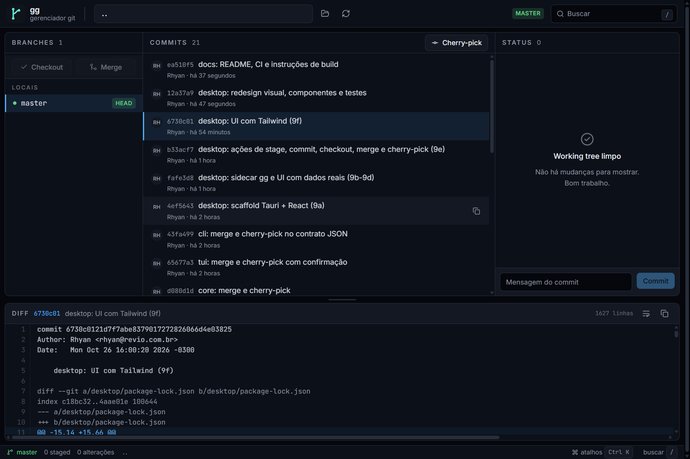

# gg desktop

Interface Tauri + React do [gg](../README.md).



## Desenvolvimento

```powershell
npm install
npm run tauri -- dev
```

> No Windows, confirme que `%USERPROFILE%\.cargo\bin` está no `PATH` (é onde o
> rustup instala `cargo` e `rustc`). O Tauri também precisa do workload
> **Desktop development with C++** do Visual Studio Build Tools.

O Tauri executa `npm run sidecar` antes de iniciar: o binário Go é compilado em
`src-tauri/binaries/gg-cli-<target-triple>.exe` e embarcado como sidecar.

## Scripts

| Script | Função |
|---|---|
| `npm run dev` | Vite puro (sem Tauri) |
| `npm run sidecar` | compila o CLI Go com o sufixo do target |
| `npm run tauri -- dev` | app desktop em modo desenvolvimento |
| `npm run tauri -- build` | release + MSI + NSIS |
| `npm run lint` | ESLint |
| `npm run test` | Vitest + Testing Library |
| `npm run build` | typecheck + build do frontend |

## Estrutura

```text
src/
  components/ui/   Button, Panel, Toast, ConfirmDialog, Skeleton, ...
  features/        branches, commits, status, diff, repo, command palette
  hooks/useRepo.ts dados + polling curto + refresh silencioso
  lib/             sidecar client, seletores, formatadores, cn()
```

A UI é uma casca fina sobre o contrato `gg --json`; toda a lógica de Git fica no
core Go e é coberta pelos testes dele.
