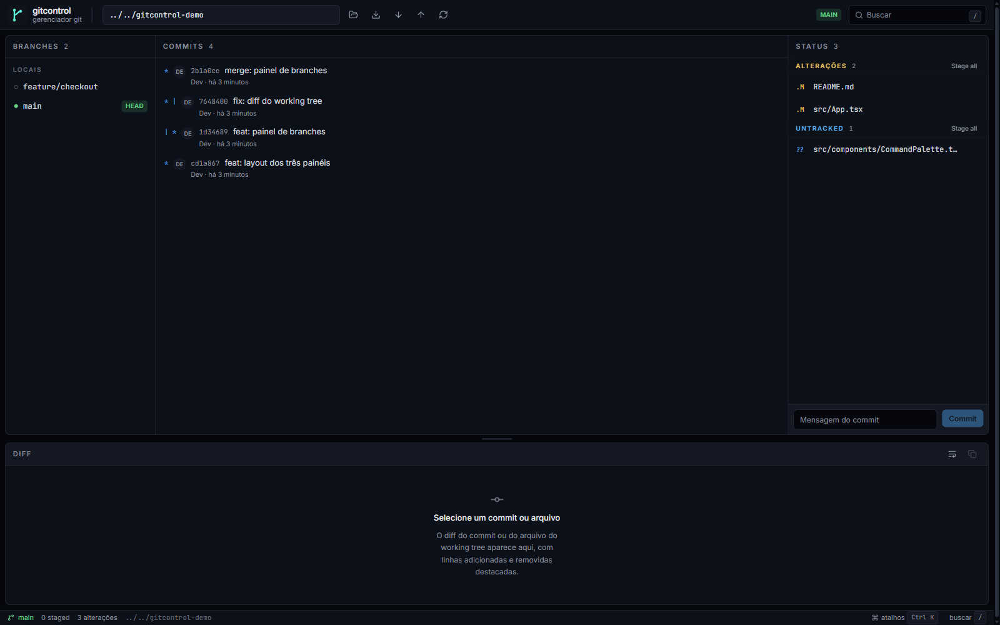

# gitcontrol desktop

Interface Tauri + React do [gitcontrol](../README.md).



## Recursos

- Branches, commits (com grafo), diff de commit e diff de arquivo do working tree.
- Criar, renomear e deletar branches; rebase.
- Stage/unstage, discard, commit e amend.
- Fetch, pull, push e gerenciamento de remotos pela paleta (`Ctrl/Cmd+K`).
- Stash (guardar/aplicar) e tags (criar).
- Reset soft/mixed/hard.
- Conflitos: abrir no editor, marcar como resolvido, continuar ou abortar.
- Vários repositórios abertos, com troca pela barra de repos e lista persistida.

## Distribuição

O release gera:

- Windows: MSI e NSIS.
- Linux (x86_64): AppImage e `.deb`.
- macOS (Apple Silicon): `.dmg`.

Linux AppImage: `chmod +x` e executar; se faltar FUSE, instale `libfuse2` ou use
`--appimage-extract-and-run`. `.deb`: `sudo apt install ./gitcontrol_*.deb`.

macOS: o `.dmg` não é assinado/notarizado. Na primeira execução use botão
direito → Abrir ou:

```bash
xattr -dr com.apple.quarantine /Applications/gitcontrol.app
```

Windows: builds sem assinatura podem acionar o SmartScreen; use **Mais
informações → Executar assim mesmo**.

## Desenvolvimento

```powershell
npm install
npm run tauri -- dev
```

> No Windows, confirme que `%USERPROFILE%\.cargo\bin` está no `PATH` (é onde o
> rustup instala `cargo` e `rustc`). O Tauri também precisa do workload
> **Desktop development with C++** do Visual Studio Build Tools.

O Tauri executa `npm run sidecar` antes de iniciar: o binário Go é compilado em
`src-tauri/binaries/gitcontrol-cli-<target-triple>.exe` e embarcado como sidecar.

## Scripts

| Script | Função |
|---|---|
| `npm run dev` | Vite puro (sem Tauri) |
| `npm run sidecar` | compila o CLI Go com o sufixo do target |
| `npm run tauri -- dev` | app desktop em modo desenvolvimento |
| `npm run tauri -- build` | release + MSI + NSIS |
| `npm run lint` | ESLint |
| `npm run test` | Vitest + Testing Library |
| `npm run build` | typecheck + build do frontend |

## Estrutura

```text
src/
  components/ui/   Button, Panel, Toast, ConfirmDialog, Skeleton, ...
  features/        branches, commits, status, diff, repo, command palette
  hooks/useRepo.ts dados + polling curto + refresh silencioso
  lib/             sidecar client, seletores, formatadores, cn()
```

A UI é uma casca fina sobre o contrato `gitcontrol --json`; toda a lógica de Git fica no
core Go e é coberta pelos testes dele.
